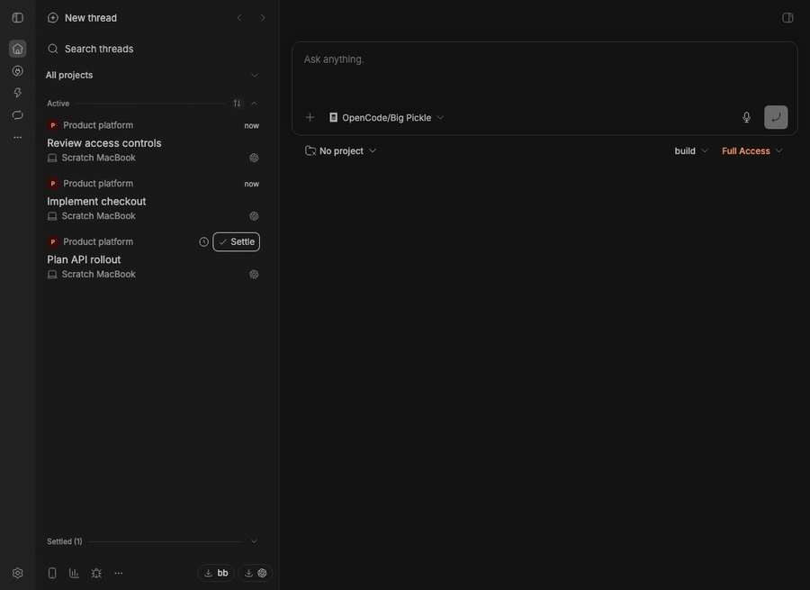

# Shelves

A sidebar for [BB](https://getbb.app) that sorts threads onto shelves: work in progress, results waiting for you, and finished conversations. Its look and behaviour follow [T3 Code](https://github.com/pingdotgg/t3code)'s sidebar.



The GIF records real interactions in a disposable BB with demo data: Settle, Un-settle, Snooze, Wake, Search.

## Features

| Shelf or action | What it does |
| --- | --- |
| **Working** | Collects running work in a collapsible shelf at the bottom. |
| **Active** | Shows recent results, errors, and questions first. |
| **Settled** | Holds filed conversations, with Un-settle and Undo. |
| **Snooze / Wake** | Defers a conversation until later, or returns it now. |
| **Automatic settling** | Files inactive threads and threads whose pull request was merged or closed. |

Filing never archives or deletes a conversation, stops a runtime, or closes a terminal. Running work, unanswered questions, queues, pins, and live children protect a thread from automatic settling, and new activity brings filed work back.

Search, thread and project creation, notifications, and retries stay BB's own. **Search threads** at the top of the sidebar, or **Cmd/Ctrl+K**, also finds settled conversations.

## Installation

Requires **BB 0.49.0 or newer**.

```sh
bb plugin install git:github.com/Jonathanm10/bb-plugin-shelves@main
bb settings ui set sidebar.threadListProvider shelves/inbox
```

The plugin ID is `shelves` and the CLI is `bb shelves`. Disable other sidebar plugins first, so their background rules do not run alongside this one.

Settings are under **Settings > Shelves**. The defaults are seven days of inactivity before a thread settles, and settling on a merged or closed pull request. The rules run when the sidebar opens and every five minutes on the server.

### Coming from Thread Inbox

Shelves keeps its own data, so it installs beside Thread Inbox. To bring your settled and snoozed threads and your settings over:

```sh
bb plugin disable shelves
sqlite3 ~/.bb/plugins/bb-thread-inbox/data.db ".backup '$HOME/.bb/plugins/shelves/data.db'"
bb plugin enable shelves
bb plugin disable bb-thread-inbox
```

Pinned projects, collapsed shelves, and the sort mode are stored in the BB app per plugin and start fresh.

## How it differs from Thread Inbox

- Thread cards follow T3 Code: the title ranks above the project, the machine a thread runs on is named, and the card has T3 Code's size and spacing.
- Settle acts on the click, and Settle and Snooze have a plain hover.
- Shelf headers are a label and a rule, without an icon.
- Settling a thread marks it read.
- The row menu shows the thread actions that other plugins add.

## Development

```sh
git clone https://github.com/Jonathanm10/bb-plugin-shelves.git
cd bb-plugin-shelves
npm ci
npm run check
```

Use Node 22; `mise.toml` pins it, and `mise exec -- npm run check` picks it up. The [browser guide](e2e/README.md) covers the isolated scratch BB that the browser tests and the demo GIF run on. [AGENTS.md](AGENTS.md) holds the working rules, and [CHANGELOG.md](CHANGELOG.md) the changes.

## Credits

Shelves is a fork of [Thread Inbox](https://github.com/ysskrishna/bb-thread-inbox) by [Y. Siva Sai Krishna](https://github.com/ysskrishna), who built the sidebar this plugin started from. Thread Inbox is based on [BB Sidebar](https://github.com/yusuf8834/bb-sidebar), with inspiration from [Sidebar Pro](https://github.com/kr3t3n/bb-plugin-sidebar-pro) and [T3 Code](https://github.com/pingdotgg/t3code).

## License

MIT. Copyright Y. Siva Sai Krishna and Jonathan M. See [LICENSE](LICENSE).
