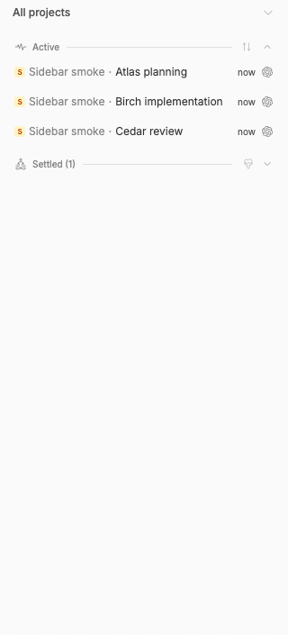

# BB Sidebar Clean

A BB sidebar for keeping work in three everyday sections:

- **Active** - results, questions, and errors ready for you, newest returns first.
- **Working** - continuing work, folded at the bottom by default. Finished or blocked work returns to Active automatically.
- **Settled** - filed conversations, collapsed and available when you need them.

Rows show project/status above the title. Snooze and Settle work on hover, keyboard focus, touch, and the row menu. Reading a conversation does not file it.

| Light | Dark |
| --- | --- |
|  |  |

## Filing and snoozing

**Settle** files finished work. **Un-settle** restores it to Active and prevents automatic settlement until new activity. **Undo** restores the previous shelves. Busy thread trees remain protected.

**Snooze** defers a thread until a chosen time. The Snoozed section appears only while used. **Wake** brings it back immediately; new attention can wake it early. An existing question can be snoozed without answering it. Queued work and continuing background activity remain protected.

Snooze and Settle leave runtimes and terminals running. Resource cleanup is a separate explicit action. Legacy Parked rows can still be resumed; normal menus do not create new Parked rows.

## Automatic settling

| Rule | Default |
| --- | --- |
| Inactive threads | Settle after 7 days |
| Merged pull requests | Settle automatically |
| Closed pull requests | Settle independently of the merge switch |
| Keep threads with a PR | Off; enable to exempt known PR threads from inactivity |

Rules run when the sidebar opens and every five minutes on the BB server, including while the browser is closed. Completed results stay Active until a rule applies. Settings changes and server restarts leave settled conversations filed; new activity can bring them back.

Running work, queued messages, pending questions, pinned threads, and live descendants prevent automatic settlement. Unknown PR data preserves the current state. PR rules use BB's GitHub PR Status plugin. Automatic settling never archives or deletes a conversation.

## Native BB features

- Search all threads, including filed ones, with **Cmd/Ctrl+K**.
- Use BB's **New thread** action and **Project picker > New project**.
- Use **Push notifications** for completion, question, and error alerts. Clicking a thread notification opens that thread. Enable completion delivery with `bb plugin config push-notifications set defaultLevel all`; per-thread and child overrides still apply. Each browser needs notification permission.

The plugin adds no second search index, project backend, or notification delivery service. Appearance, grouping, and compatibility preferences remain under Advanced settings or their existing menus. Inactive is off by default. Saved manual ordering and section expansion choices survive upgrades; choose **Recent returns** in Active's sort menu to adopt the new order on an existing device.

## Install the review branch

Requires BB 0.49.0 or newer. This branch is available for trial; it is not merged into main.

```sh
bb plugin install git:github.com/ysskrishna/bb-sidebar-clean@feature/t3-clean-sidebar --yes
bb settings ui set sidebar.threadListProvider bb-sidebar-clean/inbox
```

Disable other sidebar plugins' automatic policies before trying this one. Selecting a visual provider alone does not stop background jobs. This plugin uses its own database, browser-storage namespace, and `bb clean-sidebar` command; it does not import or overwrite Beside or BB Sidebar data.

For development:

```sh
git clone https://github.com/ysskrishna/bb-sidebar-clean.git
cd bb-sidebar-clean
git switch feature/t3-clean-sidebar
npm ci
npm run check
bb plugin install .
bb settings ui set sidebar.threadListProvider bb-sidebar-clean/inbox
```

## Scope and verification

See the approved [core specification](SPEC.md). This independent repository starts from [BB Sidebar v0.3.12](https://github.com/yusuf8834/bb-sidebar/tree/a2f65687517cc5e3513d71017cea5a3306c11313); its license and notices are preserved. The [T3 thread-sidebar guide](https://github.com/pingdotgg/t3code/blob/470ca63499293f7f680f8ad2e77381a6752f1348/docs/user/thread-sidebar.md) informed the behavior. No model or decision API is used.

This is a BB adaptation. Working order uses observed run starts because BB's sidebar API exposes no submission timestamp; unseen starts fall back to thread activity. PR eligibility uses the PR update time and available thread timestamps. Background commands and serving ports conservatively keep work visible. Pin protection is retained. Exact T3 monitor, PR-watch, and user-message semantics are outside this release.

```sh
npm run check
env -i PATH="$PATH" HOME="$HOME" npm run e2e -- --grep 'core sidebar'
```

Core browser acceptance covers light/dark layouts at 280/320px, keyboard and touch filing, Undo, Wake/Un-settle, persisted settings, and native search. The runner uses disposable BB threads and checks isolation from the real BB home. See [browser test isolation](e2e/README.md). Native notification broadcast/source checks cannot prove that an operating system displayed a banner.
