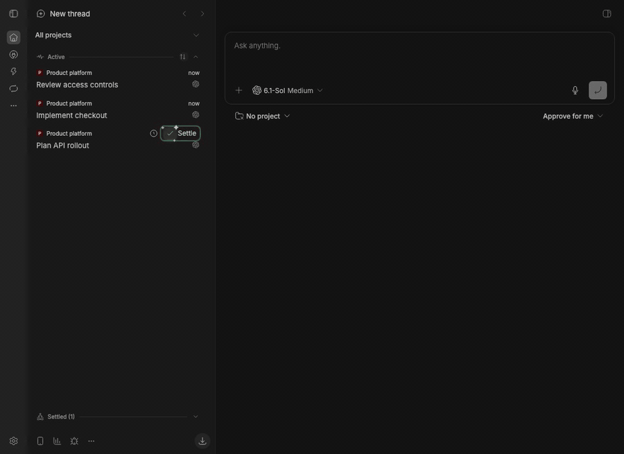
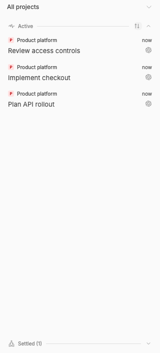
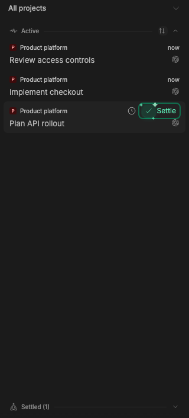
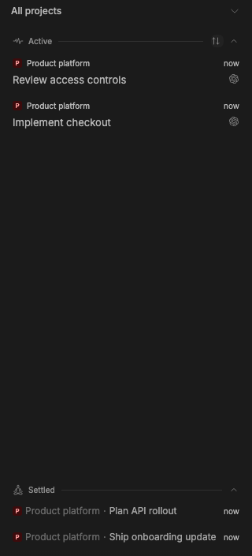
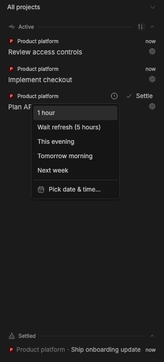
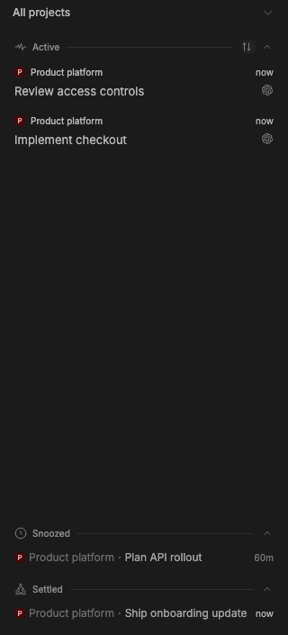
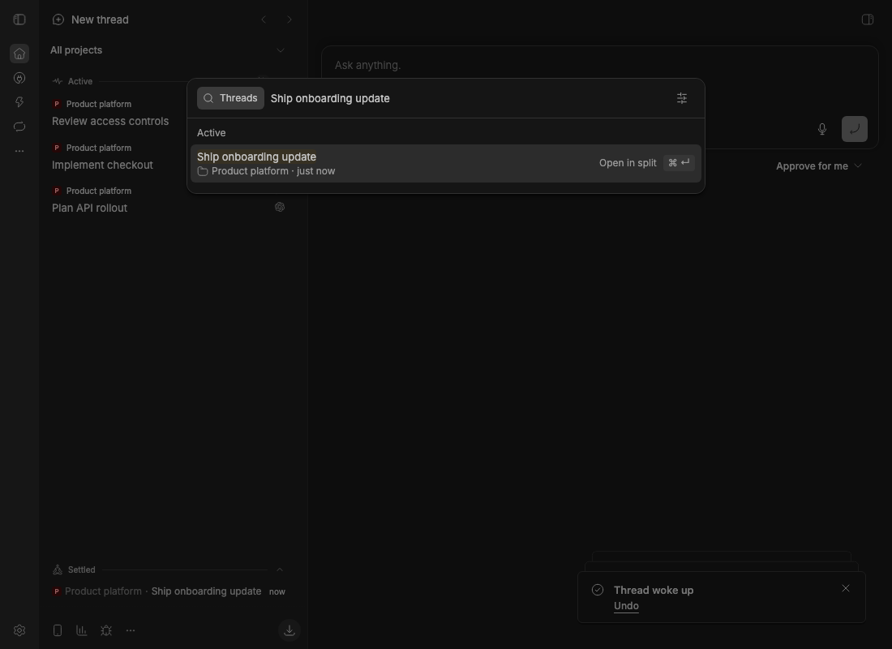
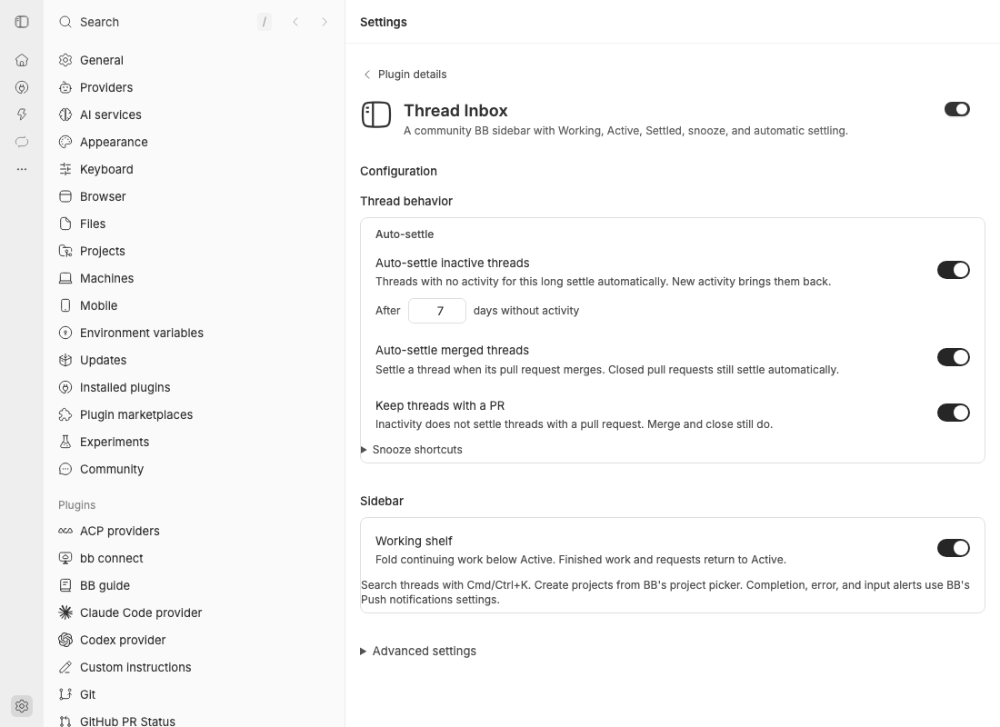

# Thread Inbox

[](https://github.com/ysskrishna/bb-thread-inbox/actions/workflows/ci.yml)
[](https://github.com/ysskrishna/bb-thread-inbox/releases)
[](LICENSE)
[](https://ysskrishna.space)

A community sidebar for [BB](https://getbb.app) that keeps ongoing work, returned results, and finished conversations easy to find.

Working stays out of the way while agents run. Active brings back results and questions. Settle completed conversations, or snooze them until you are ready to return.



The GIF records actual interactions in BB 0.50.1 with disposable demo data: **Settle → Un-settle → Snooze → Wake → Search**. Sidebar images below are cropped browser screenshots. [Capture details](docs/screenshots/README.md).

## Features

| Section or action | What it does |
| --- | --- |
| **Working** | Collects continuing work in a collapsible section at the bottom. |
| **Active** | Shows recent results, errors, and questions first. |
| **Settled** | Holds filed conversations with Un-settle and Undo. |
| **Snooze / Wake** | Defers a conversation until later or returns it immediately. |
| **Automatic settling** | Files inactive threads and threads with merged or closed pull requests. |

Filing never archives or deletes a conversation, stops a runtime, or closes a terminal. Running work reported by BB, unanswered questions, queues, pins, and live children protect threads from automatic settling. Reading alone does not settle a thread; new activity can return filed work.

Search, project and thread creation, notifications, and retries use BB's native controls. **Cmd/Ctrl+K** finds threads, including settled conversations. Use **Project picker > New project** to create a project.

## Installation

Requires **BB 0.49.0 or newer**. The release badge above reflects published GitHub Releases. A development package version does not mean a release has been published.

<details open>
<summary><b>Install the development preview</b></summary>

```sh
bb plugin install git:github.com/ysskrishna/bb-thread-inbox@main
bb settings ui set sidebar.threadListProvider bb-sidebar-clean/inbox
```

Disable other sidebar plugins before trying this one so their background policies do not run alongside it. The internal ID remains `bb-sidebar-clean` to preserve existing settings and filing data. BB shows the source for confirmation before installing it.

</details>

<details>
<summary><b>Install a published release</b></summary>

After the first release is published, select a tag from [Releases](https://github.com/ysskrishna/bb-thread-inbox/releases) and replace `vX.Y.Z` below with that exact tag:

```sh
bb plugin install git:github.com/ysskrishna/bb-thread-inbox@vX.Y.Z
bb settings ui set sidebar.threadListProvider bb-sidebar-clean/inbox
```

Git installs can also track a compatible semver range. See [BB's distribution guide](https://github.com/get-bb/bb/blob/main/plugins/bb-guide/skills/bb-plugin-authoring/references/distribution.md#releasing-a-git-plugin-with-semver-tags).

</details>

## See it in action

<details>
<summary><b>Active threads in light and dark themes</b></summary>

Returned work stays in Active. Working and Settled can stay folded at the bottom.





</details>

<details>
<summary><b>Settle and restore conversations</b></summary>

Use **Settle** to file a thread, **Undo** to reverse the last action, or expand Settled and choose **Un-settle**.



</details>

<details>
<summary><b>Snooze and wake a thread</b></summary>

Choose a shortcut or a date and time. **Wake** returns a snoozed thread immediately.





</details>

<details>
<summary><b>Search includes settled work</b></summary>

BB's native search opens a filed conversation directly.



</details>

<details>
<summary><b>Configure automatic settling</b></summary>

Open **Settings > Thread Inbox**. Defaults are seven days of inactivity, merged-PR settling on, and PR inactivity protection off. **Keep threads with a PR** exempts known PR threads from inactivity; merge and close rules still apply. Unknown PR state keeps the thread in place. Rules run when the sidebar opens and every five minutes on the server.



</details>

## Development

<details>
<summary><b>Build, check, and capture the demo</b></summary>

```sh
git clone https://github.com/ysskrishna/bb-thread-inbox.git
cd bb-thread-inbox
npm ci
npm run check
```

The [browser guide](e2e/README.md) covers the isolated scratch server, prerequisites, and reproducible screenshots/GIF. Public captures use disposable data. Working order uses observed run starts with activity fallbacks because BB exposes no sidebar submission timestamp.

Tag-based releases follow [AGENTS.md](AGENTS.md#tag-based-releases). The workflow validates stable tags and manifest versions, runs checks, and publishes the matching changelog section. Branch pushes and PRs create no release.

</details>

<details>
<summary><b>Desktop notifications</b></summary>

Check **Settings > Push notifications** in the main BB window. The desktop switch and device permission must both allow notifications. BB suppresses system alerts for a thread already focused on that client. On macOS, also check BB's notification and Focus settings. Mobile delivery is independent.

</details>

## Project links

- [Releases](https://github.com/ysskrishna/bb-thread-inbox/releases) and [issues](https://github.com/ysskrishna/bb-thread-inbox/issues)
- [Security policy](SECURITY.md)
- [Remaining scope review](docs/scope-review.md), with priorities and confidence scores
- [BB Community submission plan](docs/marketplace.md). The plugin is not listed yet.

## Inspiration

Based on [BB Sidebar](https://github.com/yusuf8834/bb-sidebar), with inspiration from [Sidebar Pro](https://github.com/kr3t3n/bb-plugin-sidebar-pro) and [T3 Code](https://github.com/pingdotgg/t3code).

## Built and maintained by

Thread Inbox is built and maintained by:

| | Name | GitHub | Role |
| --- | --- | --- | --- |
|  | **Y. Siva Sai Krishna** | [@ysskrishna](https://github.com/ysskrishna) | Creator |

## Changelog

See [CHANGELOG](CHANGELOG.md) for release history and unreleased changes.

## Support

If you find this project helpful:

- ⭐ Star the repository
- 🐛 [Report issues](https://github.com/ysskrishna/bb-thread-inbox/issues)
- 🔀 Submit pull requests
- 💝 [Sponsor on GitHub](https://github.com/sponsors/ysskrishna)

## License

MIT © [Y. Siva Sai Krishna](https://github.com/ysskrishna) - see [LICENSE](LICENSE) for details.

---

<p align="left">
  <a href="https://github.com/ysskrishna">Author's GitHub</a> •
  <a href="https://linkedin.com/in/ysskrishna">Author's LinkedIn</a> •
  <a href="https://ysskrishna.space">Author's site</a> •
  <a href="https://github.com/ysskrishna/bb-thread-inbox/releases">Releases</a> •
  <a href="https://github.com/ysskrishna/bb-thread-inbox/issues">Report Issues</a>
</p>
